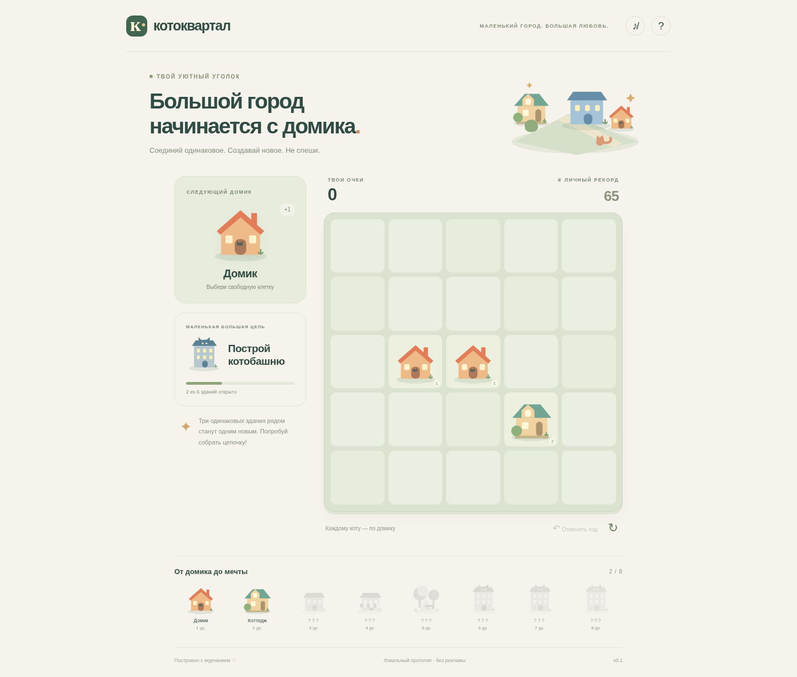

# Котоквартал

Первая браузерная игра для обучения созданию и проверке ИТ-продуктов. Уютная головоломка: ставь домики на поле 5×5, объединяй три и больше одинаковых здания по стороне, открывай новые уровни и набирай рекорд.

**Статус:** работающий локальный прототип. Не опубликован, модерация не пройдена, реальные реклама и доход не проверены. Выбор идеи — гипотеза: доступ к актуальному каталогу Яндекс Игр из среды заблокирован. Подробности в [плане продукта](docs/PRODUCT.md).

**Просто поиграть на компьютере:** [скачай проект ZIP-архивом](https://github.com/Nevedomskiy/Games/archive/refs/heads/main.zip), распакуй его и открой **`demo.html`** в браузере. Сервер и установка программ для автономной демоверсии не нужны. Сохранения браузер может ограничивать для локальных файлов. Для Яндекс Игр используется отдельная сборка ZIP из `artifacts/`.

**Посмотреть изображения:** [компьютер](docs/screenshots/desktop.png) · [телефон](docs/screenshots/mobile.png).



`demo.html` — сохранённая копия автономной версии для передачи пользователю. После изменения игры обновляй её явной командой `npm run export:demo` и включай обновление в коммит. Обычная установка и `npm run build` не меняют эту сохранённую копию. Скриншоты для README обновляются отдельно после браузерных проверок.

Облачный Chromium запрещает переходы `file://` административной политикой. Поэтому автоматическая проверка демофайла исполняет его точное содержимое в пустом документе и проверяет отсутствие сетевых запросов; открытие скачанного файла на настоящем пользовательском устройстве ещё требует ручной проверки.

## Запуск

Нужны Node.js 22+ и Python 3 (для ZIP-архива). Сервер слушает порт 5173; `PORT` меняет порт.

```sh
cd /workspace/Games
npm --cache /workspace/.cache/npm ci --ignore-scripts --no-audit --no-fund
npm run dev
```

Ручная проверка: поставь домик слева от двух начальных домиков в третьем ряду. Получится коттедж и 65 очков. Отмени ход, обнови страницу, проверь рекорд. На телефоне управление касанием; на компьютере — мышью или клавишами стрелок и Enter. Кнопка `?` объясняет правила.

## Проверки и сборка

```sh
npm test
npm run build
npm run test:browser
npm run preview
```

Для браузерных тестов нужен Chromium. В этой облачной среде он есть в `/usr/bin/chromium`; другой установленный браузер можно указать через `CHROMIUM_PATH`. Тесты запускают сервер готовой сборки автоматически, используют порт 5173 и сохраняют снимки в `artifacts/`. Для независимой проверки останови свой сервер на этом порту или задай `CI=1`, чтобы тесты не использовали уже работающий сервер.

Архив для загрузки: **`artifacts/kotokvartal.zip`**. В его корне находится `index.html`, рядом — `src/`. В приложение не входят `node_modules`, тесты и документы. Внешних шрифтов, изображений, CDN-зависимостей и ключей нет. Графика — оригинальные SVG, звук синтезируется браузером и изначально выключен.

## Что реализовано

- Чистый игровой движок отдельно от интерфейса: группы по стороне, цепочки, очки, конечное заполнение поля.
- Восемь уровней зданий, цель шестого уровня, коллекция открытий.
- Бесплатная отмена последнего хода, подтверждение новой партии.
- Локальное сохранение партии, рекорда, открытий и настройки звука. Без облачной синхронизации.
- Русский и английский языки. На платформе язык берётся из SDK; локально английский включается параметром `?lang=en`.
- Адаптивная верстка, доступные подписи клеток, управление с клавиатуры, поддержка уменьшения анимаций.
- Адаптер Yandex Games SDK: `/sdk.js` на доменах платформы, `LoadingAPI.ready`, `GameplayAPI.start/stop`, паузы и добровольное продолжение за рекламное видео.
- Награда только после `onRewarded` и закрытия рекламы; отмена/ошибка не очищает клетки. Одно продолжение за партию. Локально реклама отключена явно.

SDK проверен в автоматизированных тестах через имитацию API. Это **не подтверждает** работу рекламы и соответствие текущим требованиям площадки. Перед модерацией нужна проверка настоящего SDK в черновике игры. Не публикуй архив как окончательно готовый релиз без этих проверок.

## Структура

`src/engine.js` — правила; `src/app.js` — интерфейс и сохранение; `src/platform.js` — SDK; `src/art.js` — графика; `src/i18n.js` — тексты. `scripts/` содержит сервер и сборку, `tests/` — проверки. Сервер предназначен для разработки; площадка сама раздаёт опубликованные файлы.

Следующие шаги и тексты карточки: [docs/PRODUCT.md](docs/PRODUCT.md), [docs/PUBLISHING.md](docs/PUBLISHING.md).
