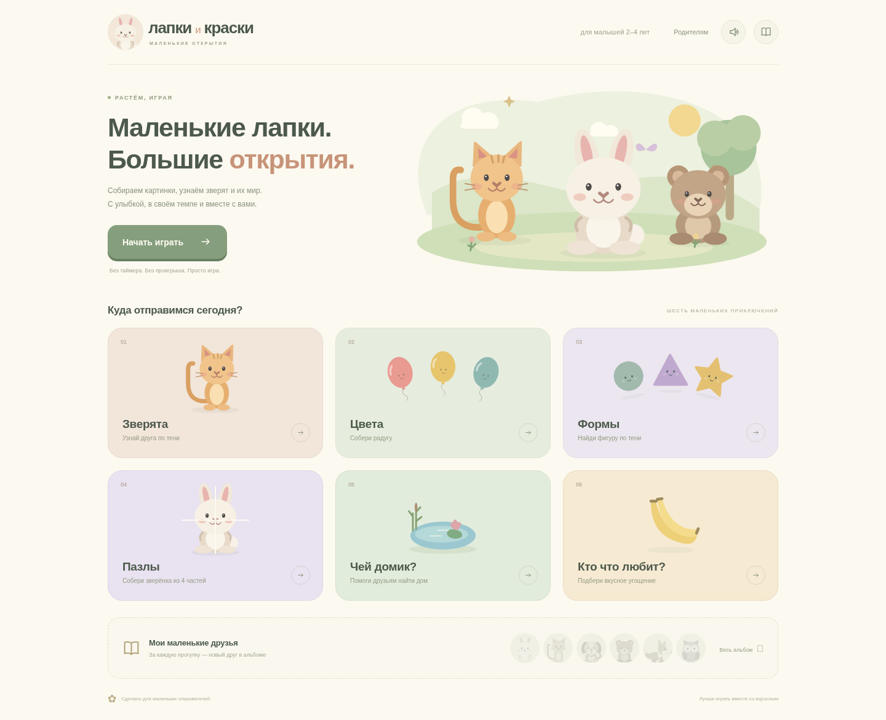

# Лапки и краски

Спокойная браузерная игра для малышей **2–4 лет**. Шесть занятий: тени зверят, цвета, формы, пазлы из четырёх частей, домики и угощения животных. Котёнок сидит прямо с тонким поднятым хвостом; лисёнок показан сбоку с длинной мордочкой и пушистым хвостом — их контуры различаются без цвета. В каждом занятии десять разных целей без повторов за прогулку — вдвое больше заданий, чем раньше. За десять заданий — наклейка в альбом. Таймера, проигрыша, рекламы, покупок и регистрации в прототипе нет.

**Статус:** локальный прототип, доступный через GitHub. На Яндекс Играх не опубликован; реальные SDK, голоса на пользовательских устройствах и модерация ещё требуют проверки. Актуальный каталог по присланной ссылке не удалось прочитать: шлюз среды возвращает 403. [Разбор гипотезы и план проверки](docs/PRODUCT.md).

## Просто поиграть

1. [Скачать проект ZIP-архивом](https://github.com/Nevedomskiy/Games/archive/refs/heads/main.zip).
2. Распаковать `Games-main`.
3. Открыть **`demo.html`** в обычном браузере на компьютере. Установка программ не требуется.

Двойной щелчок по файлу на телефоне зависит от файлового менеджера и браузера; для полноценной мобильной пробы предпочтителен черновик на площадке. В управляемом облачном Chromium переходы `file://` запрещены; автоматический тест исполняет точное содержимое демофайла в пустом документе и проверяет отсутствие внешних запросов. Открытие на настоящем устройстве отдельно не подтверждено.

[Все зверята, домики и угощения](docs/screenshots/kids-collection.png) · [Главный экран](docs/screenshots/kids-home.png) · [Котёнок и лисёнок](docs/screenshots/kids-desktop.png) · [Фигуры](docs/screenshots/kids-shapes.png) · [Пазлы](docs/screenshots/kids-puzzles.png) · [Домики](docs/screenshots/kids-homes.png) · [Угощения](docs/screenshots/kids-foods.png) · [Пазл на телефоне](docs/screenshots/kids-puzzle-mobile.png)



## Как играть

- Взрослый нажимает «Начать играть» или выбирает занятие.
- В «Зверятах» и «Формах» показана однотонная тень, без глаз, улыбки и цветных деталей. Нужно узнать контур и выбрать подходящую картинку внизу. В «Цветах» образец остаётся цветным.
- При доступном речевом синтезе браузера задание произносится по-русски. Голос не называет спрятанного зверёнка или фигуру до правильного ответа. «Послушать ещё» повторяет вопрос. Динамик отключает голос и сигналы.
- Неточный ответ оставляет то же задание и прогресс. После двух попыток в тени слегка проявляется рисунок, а подходящая карточка мягко подсвечивается.
- При правильном выборе тень становится цветной и оживает. После короткой паузы появляется следующее задание с новой скрытой тенью. Быстрые повторные нажатия не пропускают задания.
- В «Пазлах» выбери один из четырёх кусочков, затем нажми на его место в сетке 2×2. Перетаскивать не требуется. Прозрачная картинка помогает собрать целое; после двух неточных попыток подсвечивается место выбранного кусочка. Задание засчитывается только после всех четырёх частей.
- В «Чей домик?» выбери жилище для животного: лягушка — пруд, пчела — улей, птичка — гнездо, белочка — дупло, щенок — будка, муравей — муравейник, рыбка — аквариум, бобр — хатка, летучая мышь — пещера, паучок — паутинка. Правильную пару соединяет линия.
- В «Кто что любит?» подбираем знакомое угощение: обезьянка — банан, зайчик — морковка, белочка — жёлудь, корова — трава, пчела — нектар цветка, котёнок — рыбка, панда — бамбук, лошадка — сено, козочка — капуста, цыплёнок — зёрнышки. Это примеры еды, а не полный рацион. После правильного выбора появляется линия и короткое пояснение.
- После десяти заданий открывается наклейка: зайчик, котёнок, щенок, медвежонок, лисёнок или совёнок. После всех шести можно продолжать играть.
- В «Домиках» и «Угощениях» следующая задача появляется через 0,9 секунды после успеха. В остальных занятиях пауза составляет 1,6 секунды. Число заданий удвоено; общее время зависит от темпа ребёнка.
- Домой можно уйти в любой момент. Партия и альбом сохраняются в этом браузере, если хранилище доступно. Старые незаконченные прогулки переходят на новый набор; повторные цели из старой истории учитываются один раз. Альбом, звук и части текущего уникального пазла сохраняются. Синхронизации между устройствами нет.

## Разработка

Node.js 22+, Python 3 для ZIP. В облачной среде Chromium уже есть по `/usr/bin/chromium`; путь можно заменить через `CHROMIUM_PATH`.

```sh
cd /workspace/Games
npm --cache /workspace/.cache/npm ci --ignore-scripts --no-audit --no-fund
npm run dev
```

Сервер слушает `0.0.0.0:5173`; порт меняется через `PORT`. Не публикуйте этот сервер разработки как production-сервис.

```sh
npm test
npm run build
npm run test:browser
```

Браузерные тесты проверяют все шесть полных занятий, награду и сохранения (включая частично собранный пазл), ошибки и помощь, звук, SDK-паузы, клавиатуру, касания, размеры экранов и автономный HTML. Отдельно проверяются однотонность силуэтов, различие контуров котёнка и лисёнка, восстановление картинки из четырёх фрагментов и соединяющая линия у правильных пар. Для экранного диктора у картинок есть подписи. Тесты автоматически запускают preview на порту 5173 и идут последовательно: игра специально ставится на паузу при потере фокуса. Для независимого запуска освободите порт только от своего сервера и используйте `CI=1 npm run test:browser`.

`npm run build` создаёт `dist/`, `artifacts/lapki-i-kraski.zip` для площадки и автономный `artifacts/lapki-i-kraski-demo.html`. `npm run export:demo` явно обновляет отслеживаемые `demo.html` и `yandex-games.zip`; после проверки их нужно включить в коммит. [Архив для загрузки в черновик Яндекс Игр](https://raw.githubusercontent.com/Nevedomskiy/Games/main/yandex-games.zip) содержит только index.html и kids/. Обычная установка не перезаписывает эту копию и сохранённые изображения.

## Устройство проекта

`kids/data.js` — задания и пары; `kids/engine.js` — правила, включая пазл; `kids/art.js` — животные, фигуры и фрагменты; `kids/world-art.js` — домики и еда; `kids/app.js` — интерфейс, сохранения и звук; `kids/platform.js` — адаптер SDK. `scripts/` содержит сборку и сервер, `tests/` — актуальные проверки. Внешних шрифтов, изображений, аналитических SDK и ключей нет. Речевой синтез предоставляет устройство; наличие русского голоса и его работа без Интернета не гарантируются.

В репозитории оставлены текущая игра, готовый файл `demo.html` для пробы и `yandex-games.zip` для загрузки на площадку, проверки и материалы для публикации. Предыдущие прототипы доступны в истории Git. Генерируемые зависимости, сборки и отчёты проверок исключены через `.gitignore`.

Публикация и оставшиеся шаги: [docs/PUBLISHING.md](docs/PUBLISHING.md).
